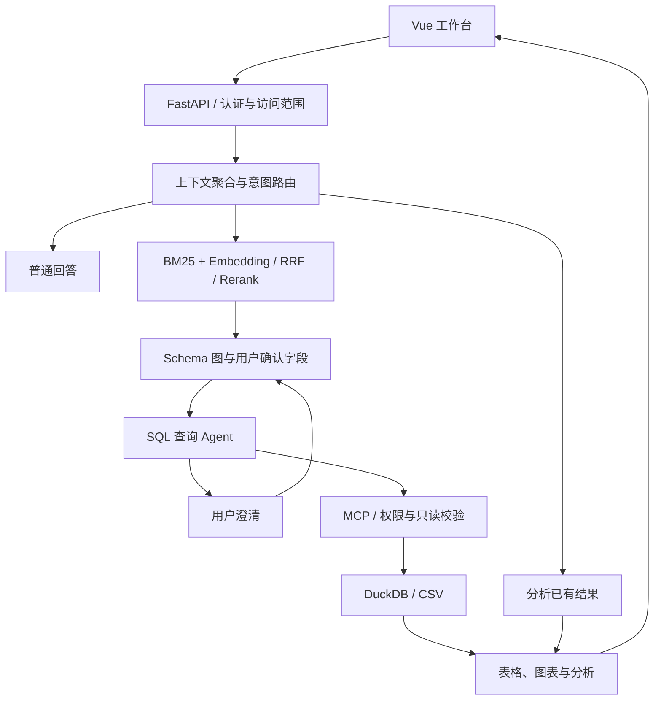

# AskData Studio

面向短视频运营的自然语言问数与数据分析应用，覆盖 **用户增长、渠道投放、内容运营** 三类场景。使用 Vue 3 构建工作台，以 FastAPI + LangGraph 编排问题理解、Schema 检索、交互式澄清、SQL 查询和结果分析。

随仓库提供 **41 张模拟 CSV 表、722,732 行数据、430 条评测用例**及历史报告，克隆后无需另行下载演示数据。

## 核心功能

- 自然语言问数：结合近期上下文理解问题，生成 SQL，通过 DuckDB 查询 CSV。
- 字段级混合检索：BM25 + Embedding 召回、RRF 融合、Rerank 精排和 Schema 图构建。
- 交互式澄清：信息不足时请求用户确认，随后恢复 LangGraph 工作流。
- 数据工作台：展示表格、图表和分析报告，支持选中结果继续提问。
- 上下文与记忆：近期对话、短期摘要、保存字段和表格、可选 SQLite 会话归档。
- 权限与工具：按角色控制数据库和表访问，通过进程内 MCP 调用工具，执行层校验只读 SQL。

## 工作流程



当前实现使用 **DuckDB + CSV** 和 **本地 JSON Schema 索引**，无需额外部署 MySQL、Milvus 或独立 MCP 服务。

## 快速开始

环境要求：Python **3.11**；Node.js **20.19+ 或 22.12+**（Vite 7 要求）；npm；可用的聊天、Embedding 和 Rerank 服务。

```bash
git clone https://github.com/lijx-dev/AskData.git
cd AskData
```

### 1. 安装后端

Windows PowerShell：

```powershell
cd backend
py -3.11 -m venv .venv
.\.venv\Scripts\python.exe -m pip install -r requirements.txt
Copy-Item .env.example .env
```

macOS / Linux：

```bash
cd backend
python3.11 -m venv .venv
./.venv/bin/python -m pip install -r requirements.txt
cp .env.example .env
```

编辑 `backend/.env`，填写自己的密钥，并确认账号支持配置的模型和接口。聊天接口兼容 OpenAI 不代表同时支持本项目使用的 Rerank 接口。

| 配置 | 示例文件默认值 / 用途 |
| --- | --- |
| `LLM_API_KEY` | API 密钥，仅写入本地 `.env` |
| `LLM_BASE_URL` | `https://dashscope.aliyuncs.com/compatible-mode/v1` |
| `LLM_MODEL` | `qwen3.7-plus`，按实际可用模型调整 |
| `EMBEDDING_MODEL` | `text-embedding-v4` |
| `EMBEDDING_DIMENSIONS` | `1024` |
| `RERANK_MODEL` | `qwen3-rerank` |
| `RERANK_BASE_URL` | `https://dashscope.aliyuncs.com/compatible-api/v1` |
| `SESSION_ARCHIVE_ENABLED` | `false`，按需启用会话归档 |

完整参数见 [环境变量示例](backend/.env.example) 和 [Settings](backend/app/config.py)。代码内置聊天模型默认值与示例文件不同，请以自己的 `.env` 为准。

### 2. 启动后端

在 `backend` 目录执行：

```powershell
# Windows
.\.venv\Scripts\python.exe run.py
```

```bash
# macOS / Linux
./.venv/bin/python run.py
```

### 3. 安装并启动前端

另开终端，从仓库根目录执行：

```bash
cd frontend
npm ci
npm run dev
```

PowerShell 如拦截 `npm.ps1`，可改用 `npm.cmd ci` 和 `npm.cmd run dev`。

| 入口 | 地址 |
| --- | --- |
| 前端工作台 | http://127.0.0.1:5173 |
| API 文档 | http://127.0.0.1:8000/docs |
| 健康检查 | http://127.0.0.1:8000/api/health |

开发服务器将 `/api` 代理到本地 8000 端口。首次问数可能需要建立向量索引，也可在后端环境中执行 `python -m scripts.prepare_schema_index` 预先构建。更换 Embedding 模型或维度后应重建索引。

### 4. 登录并体验

| 演示账号 | 密码 | 角色 |
| --- | --- | --- |
| `admin` | `admin123` | 管理员 |
| `growth` | `growth123` | 用户增长运营 |
| `channel` | `channel123` | 渠道投放运营 |
| `content` | `content123` | 内容运营 |

模拟数据覆盖 **2026-01-01 至 2026-08-28**，建议使用明确日期，直接问“今天”或“本月”可能没有数据。

- 用户增长：查询 2026 年 8 月各渠道的新增用户数。
- 渠道投放：查询 2026 年 8 月各渠道的广告消耗。
- 内容运营：查询 2026 年 8 月播放量最高的 10 条视频。
- 后续分析：选中返回表格，再问“分析各渠道的差异”。

## 仓库结构

```text
AskData/
├── frontend/                    Vue 3 + TypeScript + Vite
│   ├── src/components/          表格、图表与报告组件
│   ├── src/App.vue              登录与分析工作台
│   └── package-lock.json        前端依赖锁文件
├── backend/
│   ├── app/
│   │   ├── api/                 REST API
│   │   ├── services/            会话、记忆与应用服务
│   │   ├── workflows/           LangGraph 工作流
│   │   ├── retrieval/           字段检索与 Schema 图
│   │   ├── querying/            查询 Agent 与 DuckDB 执行器
│   │   ├── mcp_runtime/         进程内 MCP 工具
│   │   ├── security/            演示认证与访问控制
│   │   └── skills/              数据问答、数据库查询 Skill
│   ├── data/                    模拟数据与预建 Schema 索引
│   ├── scripts/                 数据生成、Schema 生成与校验
│   ├── tests/                   后端测试
│   ├── evaluation/              评测用例与历史报告
│   ├── .env.example             配置模板
│   └── run.py                   本地服务入口
├── docs/                        架构与开发说明
└── .github/workflows/ci.yml      后端检查与前端构建
```

## 测试与评测

在已安装依赖的后端环境中进入 `backend` 执行，Windows 可使用虚拟环境的 `python.exe`：

```bash
python -m unittest discover -s tests -p "test_*.py"
python scripts/validate_short_video_ops.py
python -m evaluation.run_benchmark --mode gold --scope all
```

前端在 `frontend` 目录执行 `npm run build`，包含 TypeScript 检查与 Vite 构建。

随附的 [历史全量评测报告](backend/evaluation/results/benchmark_live_all_curated.md) 记录 430 条用例：SQL 执行成功率 99.30%，查询结果正确率 82.56%。这是发布包中的历史结果，本次上传未重新运行线上模型评测。增长场景正确率 68.28%、复杂用例正确率 33.33%，仍有优化空间。

live 评测需要 API 配置并产生模型调用费用。指标和命令见 [评测说明](backend/evaluation/README.md)。

## 文档导航

- [架构与模块说明](docs/architecture.md)
- [开发与常见问题](docs/development.md)
- [模拟数据说明](backend/data/README.md)
- [MCP 工具链](backend/app/mcp_runtime/README.md)
- [评测方法](backend/evaluation/README.md)
- [来源与使用说明](NOTICE.md)

## 使用边界

当前使用固定演示账号和进程内令牌，服务重启后令牌失效；默认只监听本地地址。公开部署前需要替换认证、配置 HTTPS、审查权限隔离与模型数据传输，并完善持久化和监控。查询结果需要核验业务口径，SQL 能执行不代表答案正确。
